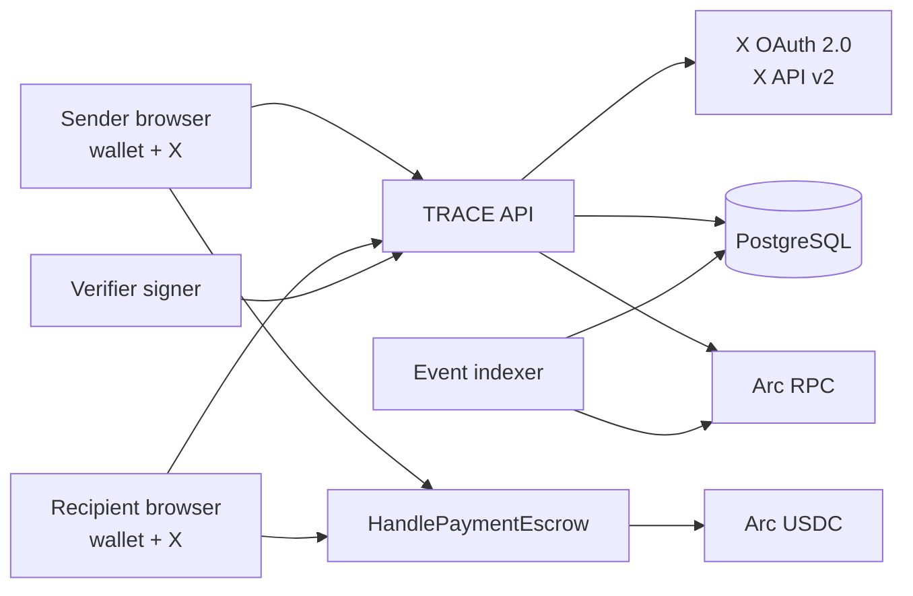
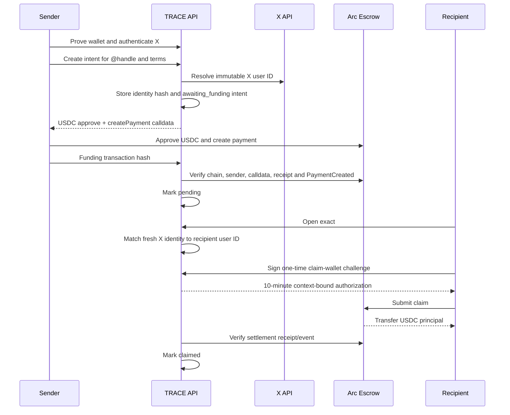
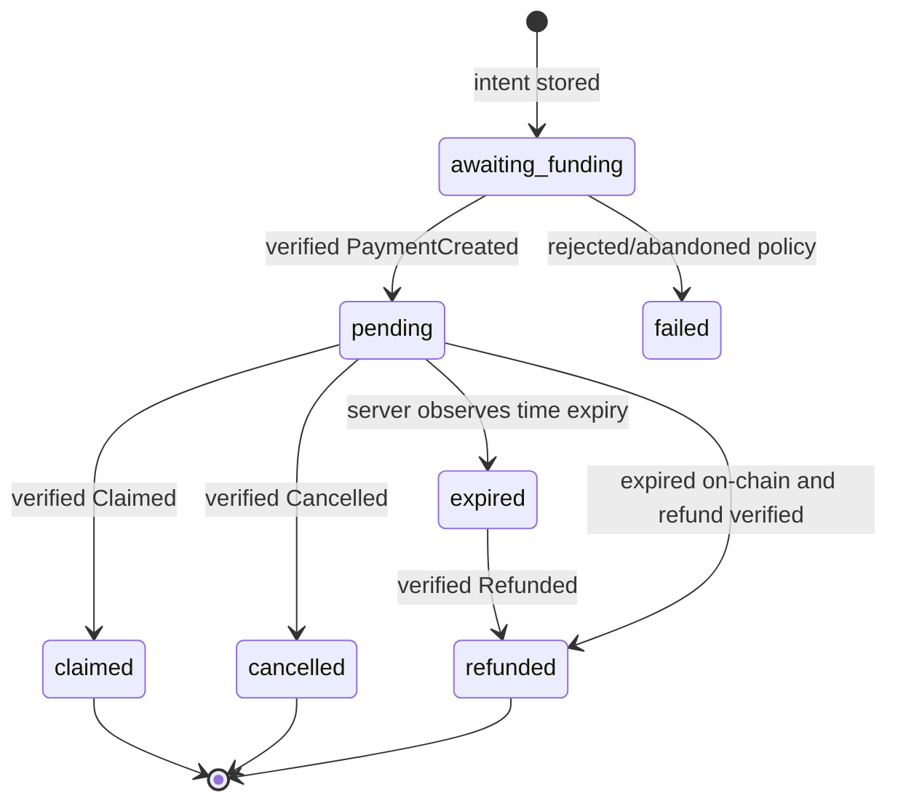

# TRACE Architecture

## Objective and core invariant

TRACE addresses an Arc USDC escrow to an immutable X user identity and releases principal only to a wallet proven by that freshly authenticated recipient.

The central invariant is:

> Database state may describe and index a payment, but only a verified Arc transaction changes the funded or settled lifecycle, and only the escrow contract moves USDC principal.

## Component map

## Responsibilities

| Component | Responsible for | Must not do |
| --- | --- | --- |
| Browser | Collect terms, connect wallet, sign challenges, submit Arc calls, render authorized state | Store OAuth client secrets or verifier keys; declare a payment funded itself |
| API | Sessions, OAuth state, X resolution, transaction construction, chain evidence verification, authorization policy, response scoping | Custody principal; trust a client-supplied lifecycle state |
| PostgreSQL | Durable identity links, payment intents, audit trail, lifecycle projection, indexer checkpoint | Act as final authority for on-chain settlement |
| Escrow | Custody principal, enforce claim/cancel/refund, route fee, prevent replay | Resolve X identities or store OAuth data |
| Verifier signer | Sign a claim digest after recipient and wallet policy checks | Hold deployer or owner authority |
| Indexer | Reconcile contract events into the database and resume from checkpoint | Produce claim authorization or move funds |
| X | Authenticate and return immutable user identity | Choose a recipient wallet |
| Arc RPC | Provide chain ID, receipts, logs, calls, and event history | Replace independent validation of expected contract/event values |

## End-to-end sequence

## Payment state model

`expired` is an API projection that enables accurate UI and refund eligibility. The on-chain payment remains pending until a refund transaction settles; expiry itself does not transfer funds.

## Identity and authorization model

TRACE joins two independent proofs inside a server session:

1. **X proof:** OAuth Authorization Code with PKCE returns the authenticated immutable X user ID.
2. **Wallet proof:** the wallet signs a one-time message containing address, nonce, issue time, expiry, and service origin.

For sending, the session must have both X and wallet identity. For claiming, the fresh X identity must equal the payment's stored recipient X ID and the requested claim wallet must equal the wallet proven in that profile. The signer then authorizes a specific payment and wallet for a short duration.

Changing an X handle does not redirect an existing payment because authorization uses the immutable X user ID and on-chain identity hash, not the display handle.

## On-chain data and digest

Each contract payment stores sender, recipient identity hash, principal amount, expiry, cancellation policy, and status. The claim digest covers:

- domain string `HANDLEPAY_CLAIM`
- Arc chain ID
- escrow contract address
- on-chain payment ID
- recipient wallet
- authorization expiry

The contract enforces payment and authorization expiry, low-s ECDSA, digest replay protection, and pending status before transfer.

## Funding verification

The API does not accept a transaction hash as proof by itself. Verification checks:

- configured Arc chain ID
- successful receipt status
- expected escrow contract destination
- transaction sender equals the verified sender wallet
- decoded `createPayment` terms match the stored intent
- matching `PaymentCreated` event exists
- identity hash, amount, fee, expiry, and cancellation policy agree

Only after these checks does `awaiting_funding` become `pending`.

## Data model

| Table | Key data | Lifecycle/security purpose |
| --- | --- | --- |
| `profiles` | X user ID, current handle, display name, wallet | Join independently proven identities |
| `sessions` | hashed token, profile link, X verification time, expiry | Server-side authorization context |
| `oauth_states` | PKCE verifier, hashed session link, safe return path, expiry | OAuth CSRF and callback integrity |
| `wallet_challenges` | hashed nonce, expected wallet, exact message, used/expiry | One-time wallet proof |
| `payments` | social identity, terms, privacy, lifecycle, chain IDs/hashes | Durable intent and chain projection |
| `audit_logs` | request ID, actor, action, target, hashed IP, metadata | Investigation and control evidence |
| `indexer_state` | durable checkpoint | Restartable event reconciliation |

## Privacy boundary

The API creates viewer-specific projections:

- unrelated viewers receive no private amount, sender, or memo value
- sender-only fields include fee, cancel policy, funding hash, and share text
- recipient-only fields include claim eligibility and claim wallet
- sender and recipient can see settlement data relevant to their flow

Public chain data remains observable. The design protects application metadata from unrelated API sessions; it does not claim transaction confidentiality.

## Trust boundaries

### Enforced on-chain

- USDC custody and transfer
- payment status transitions
- expiry and cancellation mode
- signature recovery and replay protection
- fee bounds
- pause behavior while preserving cancel/refund

### Trusted backend policy

- X identity resolution and freshness policy
- wallet challenge issuance and profile binding
- verifier key custody
- transaction/event interpretation
- privacy response shaping

### External dependencies

- X OAuth/API availability and account integrity
- Arc RPC correctness and availability
- wallet provider behavior
- PostgreSQL durability
- infrastructure, DNS, TLS, monitoring, and managed signer

## Configuration gates

The system fails closed:

- no X bearer token: recipient lookup is unavailable
- no X client ID: OAuth cannot start
- no escrow address: payment creation is unavailable
- no verifier key: claim authorization is unavailable
- wrong RPC chain: funding verification and claim authorization are rejected

No gate falls back to a synthetic X ID, mock chain record, or server-side token balance.

## Deployment topology

### Current local topology

- Node.js/Express serves API and browser application
- PostgreSQL runs in Docker
- separate polling indexer process
- injected EVM wallet signs and submits Arc transactions
- environment-configured testnet verifier signer

### Target pilot topology

- HTTPS reverse proxy/CDN
- at least two application replicas only after shared session/rate-limit readiness
- managed PostgreSQL with point-in-time recovery
- dedicated indexer worker
- primary and fallback Arc RPC
- managed secrets and isolated verifier signer
- centralized structured logs, metrics, alerts, and uptime checks

## Availability and recovery

- Browser/API outage does not move escrowed funds.
- Indexer outage delays the database projection but does not alter contract state.
- RPC outage blocks verification and new authorizations rather than guessing state.
- X outage blocks new recipient resolution and claims that require fresh authentication.
- Database recovery must restore sessions/payments/audits and then replay contract events from the durable deployment/checkpoint range.
- Contract pause blocks create and claim but deliberately leaves sender cancellation and expired refund available.

## Architectural decisions before mainnet

1. Select a managed signer/KMS path that supports the required Ethereum signature format.
2. Decide verifier governance, rotation, revocation, and monitoring.
3. Add shared rate-limit/session behavior for multi-replica deployment.
4. Establish RPC redundancy and reorg/finality policy.
5. Define event retention, log access, backup RPO/RTO, and incident ownership.
6. Complete an external review of contract and backend authorization boundaries.
